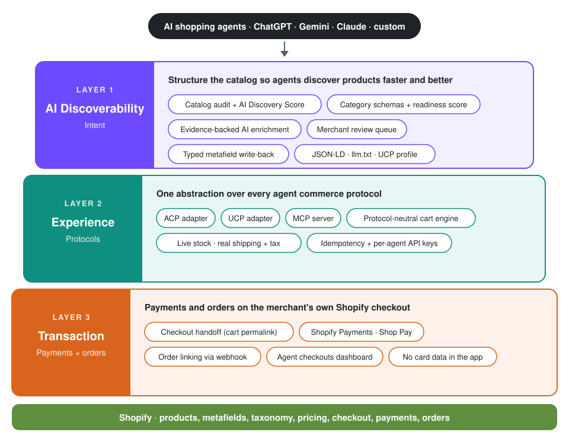
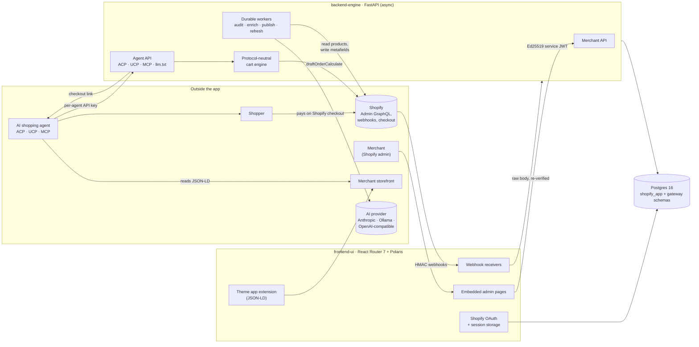
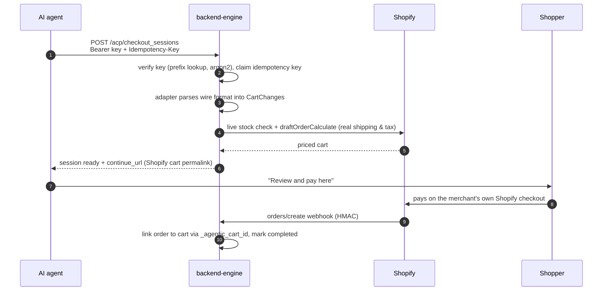

<div align="center">

# Agentic Commerce Gateway

**A production-grade Shopify app that makes a merchant's catalog discoverable, understandable and purchasable by AI shopping agents.**

[](https://github.com/rajatrao/agentic_commerce_gateway/actions/workflows/ci.yml)


[Architecture](#architecture) · [Engineering highlights](#engineering-highlights) · [Design decisions](#key-design-decisions) · [Features](#what-it-does) · [Run it locally](#run-it-locally) · [Deep-dive docs](#documentation)

</div>

---

## Why this exists

Shoppers increasingly ask ChatGPT, Gemini, Claude and custom agents to find and buy products for them. Those agents can only recommend what they can **read** and only buy through what they can **call**. Most Shopify catalogs fail on both counts: key facts (capacity, weight, material, waterproofing) are buried in prose or missing entirely, and there is no machine interface for building a cart.

This gateway closes both gaps for a merchant, end to end:

1. **Get found.** Audit every product against what agents need for its category, extract missing attributes from the product's own content with evidence, let the merchant review them, and write approved values back to Shopify as typed metafields. Publish the catalog as storefront JSON-LD, a streaming `llm.txt` feed and a UCP discovery profile.
2. **Get bought.** Expose the catalog to approved agents through **three agent commerce protocols (ACP, UCP and MCP)** backed by one protocol-neutral cart engine with live stock and real shipping and tax. Hand the shopper to the merchant's **own Shopify checkout**, so the app never touches payment.

## At a glance

| | |
|---|---|
| **Scope** | Two services, one Postgres database, a Shopify theme extension, 12 embedded admin pages |
| **Code** | ~21k lines of Python, ~7k lines of TypeScript |
| **Agent protocols** | OpenAI's Agentic Commerce Protocol (ACP), Universal Commerce Protocol (UCP), Model Context Protocol (MCP) |
| **AI providers** | Anthropic, Ollama (local models such as Qwen), or any OpenAI-compatible endpoint, behind one schema-constrained interface |
| **Quality gates** | ~190 backend tests (unit and Postgres integration), frontend Vitest suite, `ruff`, `mypy`, ESLint, `tsc`, and an `alembic check` that fails CI when migrations drift from models |
| **Scaling model** | Stateless replicas; all shared state and job queues live in Postgres |

---

## Architecture

### Three layers

<p align="center">
  
</p>

The gateway is built as three layers that take a merchant from *being found* by an AI agent to *being paid*:

| Layer | Goal | How it is built |
|---|---|---|
| **1. AI Discoverability / Intent** | Improve catalog structure so AI agents discover and understand products faster and better | Catalog audit and AI Discovery Score, category schemas and readiness score, evidence-backed AI enrichment, merchant review, typed metafield write-back, storefront JSON-LD, `llm.txt` and a UCP discovery profile |
| **2. Experience** | One abstraction over the agent commerce protocols, so every agent shops the same catalog the same way | Pure ACP, UCP and MCP adapters over a protocol-neutral cart engine with live stock, real shipping and tax, idempotent writes and per-agent API keys |
| **3. Transaction** | Payments and order management | Handoff to the merchant's own Shopify checkout (Shopify Payments, Shop Pay or any gateway), `orders/create` webhook linking each order back to its agent cart, and an agent checkouts dashboard. The app never handles card data |

### System components



| Component | Stack | Responsibility |
|---|---|---|
| [`frontend-ui/`](frontend-ui) | React Router 7 (Shopify's Remix successor), Polaris web components, Prisma, TypeScript | Shopify OAuth and sessions, the embedded merchant dashboard, webhook receivers, and a theme app extension that injects Product and Organization JSON-LD into the storefront |
| [`backend-engine/`](backend-engine) | Python 3.12, FastAPI, SQLModel on async SQLAlchemy (psycopg 3), Alembic, Pydantic | All business logic: catalog audit and enrichment, metafield write-back, agent protocol adapters, cart engine, durable background workers |
| Postgres 16 | One database, two schemas | Prisma owns `shopify_app` (sessions only); Alembic owns `gateway` (all domain tables). Neither service migrates the other's schema |

The browser never calls backend-engine directly. Every dashboard request goes browser → frontend-ui loader → backend-engine with a 60-second, single-use, Ed25519-signed service token.

### Backend layering

The backend is a strict layered architecture. Each layer imports only from the layers below it: nothing below `api` imports FastAPI, and business services never import a protocol adapter.

```
api/            HTTP edge: routers, auth dependencies, idempotency, MCP mount
protocols/      pure adapters: ACP / UCP / MCP wire format  <->  protocol-neutral cart model
jobs/           durable Postgres-queue workers and job bodies
services/       business rules; Shopify, storefront and AI I/O behind small client classes
repositories/   database access, one class per aggregate, always scoped by merchant
models/         SQLModel tables (gateway schema)
core/           config, async DB sessions, JWT / HMAC / encryption, secret-redacting logs
```

Adding a fourth agent protocol means writing one adapter; the cart engine, stock checks, pricing and checkout handoff are reused unchanged.

### Agent checkout, end to end



The full journey from install to checkout, including onboarding, audits and enrichment, is drawn in [docs/flow.md](docs/flow.md).

---

## Engineering highlights

**Durable job processing without extra infrastructure.** Audits, enrichment, publishing, refreshes and store search tests run on Postgres-backed queues instead of in-request tasks or a separate broker. Workers claim jobs with `SELECT … FOR UPDATE SKIP LOCKED`, heartbeat while running, and **fence every write on `(id, attempt, status)`** so a worker that was presumed dead can never overwrite a newer attempt. Transient failures retry with linear backoff, permanent ones (store uninstalled, token revoked) fail immediately, and graceful shutdown releases jobs without spending an attempt. Enrichment and publishing resume where they stopped.

**One cart engine, three protocols.** ACP, UCP and MCP are thin, pure adapters over a single `CartManager` that re-checks live inventory on every change, clamps over-requests with a warning, and prices through Shopify's `draftOrderCalculate`, so shipping and tax come from the merchant's own settings. ACP and UCP writes are idempotent: a retry with the same key and body replays the stored response; the same key with a different body gets `409`.

**Evidence-backed AI that resists prompt injection.** Enrichment runs a deterministic rule extractor and, optionally, an LLM. Product text is passed to the model as delimited JSON data, never as instructions, and every value the model returns must cite a quote that **actually occurs in the product content and contains the value**. Instruction-like quotes are rejected, unstated values stay empty, and output is constrained to the same JSON schema for every provider. Each suggestion records its evidence, source, method, confidence and validation result.

**Human-in-the-loop writes that are safe to retry and to undo.** Nothing is published automatically. Merchants review suggestions, preview every metafield change (create, update, unchanged or blocked), and confirm. Writes use `metafieldsSet` with `compareDigest`, so concurrent edits in Shopify admin are never clobbered, and every write is logged with before and after values and can be reverted. Opt-in auto-approval only fires when a value fills an empty field, passes validation with no warnings, was independently confirmed by rule extraction, and clears a confidence threshold.

**Zero-trust service boundaries.** The two services authenticate each other with separate Ed25519 key pairs, short-lived tokens with audience, issuer and scope checks, and single-use `jti` values stored in Postgres so replays fail across replicas. Shopify webhooks are HMAC-verified twice (frontend and backend) and deduplicated. Agent keys are argon2-hashed, scoped to one protocol and revocable. Offline tokens are Fernet-encrypted at rest, and logs redact secrets.

**Horizontally scalable by design.** Every piece of shared state (JWT replay guard, `llm.txt` cache, job queues, idempotency records) lives in Postgres; the remaining in-process caches only save work and never affect correctness. All backend database access is async, and CPU-heavy steps (argon2, HTML parsing) run in worker threads so the event loop never stalls.

**Built to the platform's rules.** An earlier design charged payments and created orders directly. It was deliberately replaced with a checkout handoff to stay within [Shopify App Store rule 1.1.2](https://shopify.dev/docs/apps/launch/shopify-app-store/app-store-requirements), which forbids bypassing Shopify checkout. The app now handles no money and stores no customer details beyond an order id and name, and GDPR `customers/redact` clears any buyer details agents sent.

## Key design decisions

| Decision | Why |
|---|---|
| Two services instead of one | Shopify's first-party app tooling (OAuth, session refresh, embedded UI, theme extensions) is JavaScript; the catalog, AI and protocol work is a better fit for Python's typing and data tooling. A signed service-JWT contract keeps the boundary explicit. |
| One database, two schemas, two migration tools | Each service owns and migrates only its schema, so deploys stay independent without the cost of a second database. |
| Postgres as the job queue | `SKIP LOCKED`, heartbeats and fencing give at-least-once, crash-safe processing with no Redis or broker to run and monitor. |
| frontend-ui owns Shopify token refresh | Shopify offline tokens now expire. Letting a single owner refresh them means the two services can never invalidate each other's refresh tokens; the backend asks the frontend for a fresh token over a second signed channel. |
| Protocol-neutral cart model | Agent protocols are young and changing. Isolating wire formats in pure adapters keeps the business logic stable and each protocol cheap to update or add. |
| Hand off to Shopify checkout | Complies with App Store rules, keeps the merchant's payment gateways, fraud tools and order flow intact, and removes PCI scope from the app entirely. |
| Rules first, AI optional | The system works with no model configured; AI widens coverage but every AI value must pass the same evidence check as a rule-based one. |

---

## What it does

<details>
<summary><b>Storefront check</b>: can agents read the store at all?</summary>

Fetches the homepage, a product page, `robots.txt` and `llms.txt` behind an SSRF guard (public hosts only, re-checked after redirects, response size capped). Verifies Product, Offer, Organization and WebSite JSON-LD, OpenGraph and Twitter metadata, the theme block marker and whether AI crawlers are allowed. The dashboard's setup guide deep-links the merchant into the theme editor to turn on the app's JSON-LD block and embed.
</details>

<details>
<summary><b>AI Discovery Score</b>: how legible is each product to an agent?</summary>

Each active product is scored 0-100 across eight weighted dimensions: identity 15, description 20, media 15, identifiers 15, offers 10, taxonomy 10, attributes 10, reviews 5. The store score is the average. Meta mapping rules let merchants credit facts already encoded in tags, vendor, product type or metafields (for example a `brand:(.+)` tag rule), with a live preview against the store's products before saving. See [docs/catalog-audit.md](docs/catalog-audit.md).
</details>

<details>
<summary><b>Catalog intelligence</b>: category schemas, findings and a readiness score</summary>

Built-in category schemas (backpacks, tents, sleeping bags, outerwear, footwear, general) define each attribute's type, unit, allowed values, importance and target metafield; merchants can edit or add their own. The audit raises evidence-quoted findings such as `attribute_missing`, `attribute_buried`, `attribute_contradiction` and `claim_unsupported`, and computes a transparent readiness score:

```
score = 100 × Σ(weight × value) / Σ(weight)     over the components that apply
```

| Component | Weight | Measures |
|---|---|---|
| Completeness | 30 | importance-weighted share of schema attributes with a valid value |
| Validity | 15 | structured values that parse and fit the schema |
| Consistency | 15 | structured values that agree with the description |
| Evidence | 10 | claims (waterproof, recycled, …) backed by a structured field |
| Variants | 10 | SKUs, prices and the options the category expects |
| Foundation | 20 | AI Discovery Score / 100 |

Weights and the agent-ready threshold are configurable. Discovery tests show how many products could answer realistic shopper questions ("lightweight hiking backpack around 30 liters"), and a **store search test** asks those questions of the store's own search through its Storefront MCP endpoint and reports recall.
</details>

<details>
<summary><b>Enrichment, review and write-back</b>: fixing the gaps safely</summary>

1. A worker re-reads each selected product and runs the rule extractor plus the optional AI model.
2. Every proposed value is validated against a quote from the product's own content.
3. Suggestions land in the **Review queue** (approve, edit-and-approve with server-side validation, reject, bulk actions), or pass through opt-in auto-approval.
4. A preview shows every metafield change; a confirmed publish runs as a background job with progress.
5. Values are written as typed custom metafields, and attributes mapped to Shopify's standard taxonomy also fill category metafields and metaobject entries.
6. Every change is logged and revertible, and a single-product refresh re-scores the product immediately.

See [docs/catalog-enrichment.md](docs/catalog-enrichment.md).
</details>

<details>
<summary><b>Agent feed and protocols</b>: llm.txt, ACP, UCP and MCP</summary>

`GET /api/v1/agent-gateway/llm.txt?shop=<store>` streams policies, brand FAQs, collections and products as compact Markdown, cached in Postgres for 10 minutes.

Merchants issue one API key per agent on the **Agent access** page. Agents authenticate with `Authorization: Bearer acg_live_…`.

| Protocol | Endpoints | Notes |
|---|---|---|
| ACP | `POST /api/v1/acp/checkout_sessions`, `GET`/`POST …/{id}`, `POST …/{id}/cancel` | [Agentic Checkout spec](https://developers.openai.com/commerce/specs/checkout), amounts in minor units |
| UCP | `POST /api/v1/ucp/checkout-sessions`, `GET`/`PUT …/{id}`, `POST …/{id}/cancel`, discovery at `/.well-known/ucp` | [UCP checkout REST binding](https://ucp.dev/specification/shopping/checkout/rest/) with the fulfillment extension |
| MCP | `POST /mcp` (streamable HTTP, stateless JSON) | Tools: `search_products`, `get_product`, `create_cart`, `update_cart`, `get_cart`, `cancel_cart` |

A `ready` cart carries a Shopify cart permalink with lines, email and address prefilled and a hidden `_agentic_cart_id` attribute. ACP returns it as `continue_url`, UCP returns `requires_escalation`, and MCP includes `checkout_url`. When the shopper pays, the `orders/create` webhook links the Shopify order back to the agent cart, and the merchant sees every agent cart and its outcome on the **Agent checkouts** page. See [docs/agentic-commerce.md](docs/agentic-commerce.md).
</details>

---

## Tech stack

| Area | Technologies |
|---|---|
| Backend | Python 3.12, FastAPI, Pydantic, SQLModel, async SQLAlchemy, psycopg 3, Alembic, argon2, PyJWT (EdDSA), Fernet, httpx |
| Frontend | React Router 7, TypeScript, Shopify Polaris web components, Shopify App Bridge, Prisma, Liquid (theme extension) |
| AI | Anthropic API, Ollama (Qwen), OpenAI-compatible endpoints (vLLM, LM Studio, OpenRouter) |
| Protocols | ACP, UCP, MCP, Shopify Admin GraphQL `2026-10`, Storefront MCP |
| Data and infra | Postgres 16, Docker multi-stage builds, Docker Compose |
| Quality | pytest with real Postgres integration tests, Vitest, ruff, mypy, ESLint, GitHub Actions |

## Repository layout

```
backend-engine/
  app/api/            FastAPI routers, auth dependencies, idempotency, MCP mount
  app/protocols/      ACP / UCP adapters and the MCP server
  app/services/       catalog auditor, readiness, enrichment, AI enricher, cart manager,
                      metafield and taxonomy writers, Shopify client, order linker, …
  app/jobs/           durable workers: audits, enrichment, publish, refresh, discovery
  app/repositories/   merchant-scoped database access
  app/models/         SQLModel tables (gateway schema)
  migrations/         Alembic
  tests/              unit and Postgres integration tests
frontend-ui/
  app/routes/         embedded admin pages and webhook receivers
  app/lib/            service-JWT minting and the typed backend client
  extensions/         theme app extension (JSON-LD blocks)
  prisma/             Shopify session storage (shopify_app schema)
docs/                 architecture, flow and feature deep dives
```

---

## Run it locally

You need [Docker Desktop](https://www.docker.com/products/docker-desktop/) (or OrbStack), [Node 22](https://nodejs.org/), the [Shopify CLI](https://shopify.dev/docs/api/shopify-cli) (`npm install -g @shopify/cli`) and a Shopify Partner account with a development store. The Shopify app (frontend-ui) runs on your machine with the Shopify CLI; Docker runs Postgres and backend-engine.

**First time**

```bash
make keys                 # generate the service keys into ./.env and frontend-ui/.env
cd frontend-ui
npm install
npm run config:link       # sign in to Shopify and pick (or create) your app
npm run env show          # copy SHOPIFY_API_KEY and SHOPIFY_API_SECRET into ../.env
```

**Every time**

```bash
make up                   # Postgres :5432, backend-engine :8000 (OpenAPI docs at /docs)
cd frontend-ui
npm run dev               # Shopify CLI: tunnel, install on the dev store, app on :3000
```

Open the preview link the CLI prints to use the app inside Shopify admin. Migrations run on start and code changes reload automatically. Then use the dashboard's **Setup guide** to turn on the product data block and store data embed in the theme editor.

**Optional local AI model:** `make up-ollama` adds an Ollama container and pulls `qwen3:8b` (about 5 GB) for enrichment. Set `AI_MODEL` in `.env` to use a smaller model such as `qwen3:4b`.

### Tests and checks

```bash
make test        # backend pytest (against Postgres) + frontend Vitest
make lint        # ruff, ruff format, mypy, ESLint, tsc
make prod-smoke  # build and run the production images locally
```

---

## Documentation

| Doc | What's in it |
|---|---|
| [docs/architecture.md](docs/architecture.md) | Full system design: layers, routers, services, workers, data model, security boundaries, configuration |
| [docs/flow.md](docs/flow.md) | End-to-end flow from install to an agent sending a shopper to checkout, with diagram |
| [docs/catalog-audit.md](docs/catalog-audit.md) | The catalog audit and its scores from first principles, with a worked example |
| [docs/catalog-enrichment.md](docs/catalog-enrichment.md) | How missing product data is found, validated, reviewed and written back |
| [docs/agentic-commerce.md](docs/agentic-commerce.md) | How AI agents shop the store through ACP, UCP and MCP |

---

<div align="center">

Designed and built by **[Rajat Rao](https://github.com/rajatrao)**.

</div>
