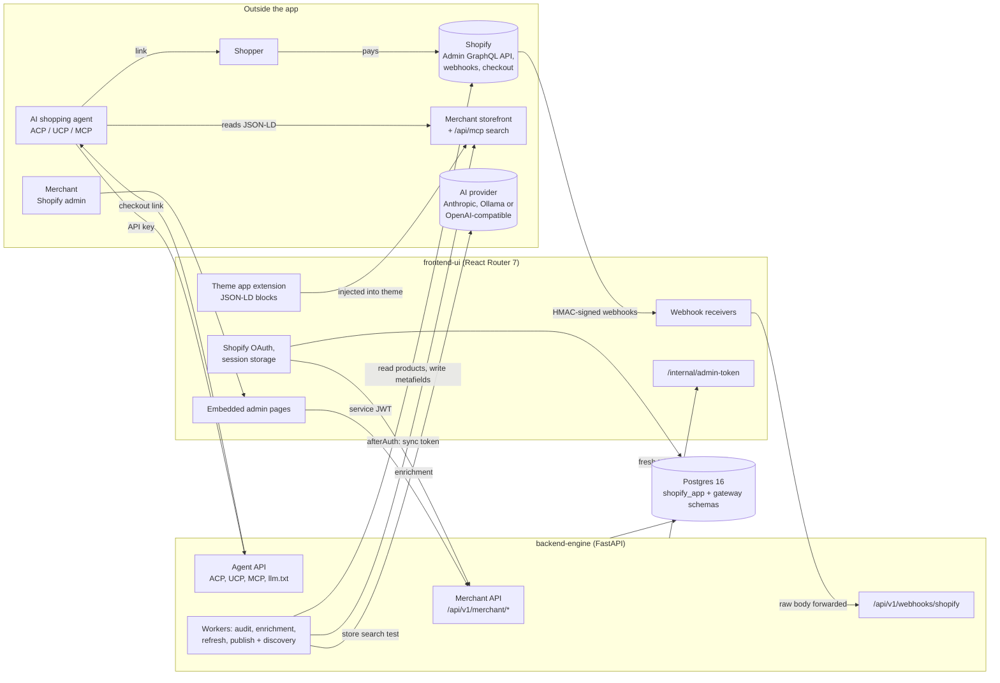

# Agentic Commerce Gateway: architecture

How the system is built today, read from the code on branch `feature/meta-mapping-rules` (everything on `main` plus the Meta mapping rules page), with the unmerged `fix/theme-extension` changes called out in section 12. For the step-by-step journey see [flow.md](flow.md). For the catalog features in depth see [catalog-audit.md](catalog-audit.md) and [catalog-enrichment.md](catalog-enrichment.md); those two also define the ecommerce terms used here (variant, metafield, taxonomy and so on).

The original planning blueprint this replaces is in git history (`git show f2e0cf0:docs/architecture.md`).

---

## 1. What the system does

A Shopify app that makes a merchant's catalog **understandable** and **purchasable** by AI shopping agents (ChatGPT, Gemini, Claude and custom agents).

1. **Get found.** It checks the storefront exposes machine-readable data, audits every product against what agents need for its category, proposes missing attribute values from the product's own content, and writes the values the merchant approves back to Shopify as typed fields. It also publishes the catalog in agent-friendly formats: JSON-LD on the storefront, an `llm.txt` feed and a UCP discovery profile.
2. **Get bought.** It lets agents the merchant has approved build priced carts through three agent protocols (ACP, UCP, MCP). When a cart is ready, the agent hands the shopper a link to the store's **own Shopify checkout**. The app never takes payment or creates orders; the result is a normal Shopify order, which the app links back to the agent's cart.

## 2. The pieces

| Component | Stack | Owns |
|---|---|---|
| **frontend-ui** | React Router 7 (Shopify's successor to Remix), Polaris web components, Prisma | Shopify OAuth and sessions, the embedded admin pages, webhook receivers, the theme app extension. Its database schema `shopify_app` holds only Shopify sessions and its JWT replay guard. |
| **backend-engine** | Python 3.12, FastAPI, SQLModel on async SQLAlchemy (psycopg 3), Alembic | All business logic, the merchant and agent APIs, background workers. Owns the `gateway` schema. |
| **Postgres 16** | One database, two schemas | Prisma migrates `shopify_app`, Alembic migrates `gateway`; neither touches the other's. |
| **Shopify** | Admin GraphQL API `2026-10` | Products, metafields, taxonomy, pricing (`draftOrderCalculate`), checkout, webhooks. |
| **AI provider** (optional) | Anthropic, Ollama or any OpenAI-compatible endpoint | Attribute extraction and semantic review during enrichment. Without one, enrichment uses rules only. |

The browser never calls backend-engine. Every dashboard request goes browser → frontend-ui loader or action → backend-engine with a short-lived signed token.

---

## 3. backend-engine

### 3.1 Layers

Each layer only imports from the layers below it. Nothing below `api` imports FastAPI, and `services` never imports a protocol adapter.

| Layer | Package | Role |
|---|---|---|
| App factory | `app/main.py` | Builds the app, starts and stops the workers in its lifespan, mounts routers and `/mcp`, renders protocol errors in each protocol's shape, `GET /health`. |
| Cross-cutting | `app/core/` | Settings (`config.py`), async database and sessions (`db.py`), structured logging with secret redaction (`logging.py`), JWT, HMAC and token encryption (`security.py`). |
| HTTP edge | `app/api/` | Routers, auth dependencies (`deps.py`), agent auth and idempotency (`agent.py`), the MCP mount (`mcp.py`). |
| Wire schemas | `app/schemas/` | Pydantic request and response models for the merchant API. |
| Protocols | `app/protocols/` | Pure adapters between ACP / UCP / MCP wire formats and the protocol-neutral cart model. |
| Jobs | `app/jobs/` | Durable Postgres queue workers and the job bodies. |
| Services | `app/services/` | Business rules. Shopify, storefront and AI I/O sit behind small client classes. |
| Repositories | `app/repositories/` | Database access, one class per aggregate, always scoped by merchant. |
| Models | `app/models/` | SQLModel tables in the `gateway` schema. |

### 3.2 Routers

| Router | Prefix | Called by, auth | What it does |
|---|---|---|---|
| `internal.py` | `/internal` | frontend-ui, service JWT with `internal:sync` | `POST /merchants/sync` stores the shop's offline token (encrypted) at install. |
| `merchant.py` | `/api/v1/merchant` | frontend-ui, service JWT | Installation check (run, latest), `GET /me`. |
| `audits.py` | `/api/v1/merchant` | frontend-ui | Queue an audit, latest summary and product page; **meta mapping rules** CRUD, live preview (`POST /mapping-rules/preview`) and on/off toggle (`PATCH`); brand FAQs for `llm.txt`. |
| `catalog.py` | `/api/v1/merchant/catalog` | frontend-ui | Catalog intelligence: overview, runs, products and product detail, findings, enrichment jobs, suggestions and review, publish preview and jobs, store search test runs, change log and revert, category schemas, auto-approval, metafield mappings, readiness settings. |
| `agent_clients.py` | `/api/v1/merchant/agent-clients` | frontend-ui | Create (key shown once), list and revoke agent API keys. |
| `orders.py` | `/api/v1/merchant` | frontend-ui | `GET /agent-checkouts`: every agent cart with its link and resulting order. |
| `webhooks.py` | `/api/v1/webhooks` | Shopify via frontend-ui, HMAC | Uninstall, GDPR, `orders/create`, `products/update`, `products/delete`. |
| `agent_gateway.py` | `/api/v1/agent-gateway` | public | `GET /llm.txt?shop=` streams the store as Markdown. |
| `acp.py` | `/api/v1/acp` | agent key (ACP) + `Idempotency-Key` | ACP checkout sessions: create, get, update, cancel, complete. |
| `ucp.py` | `/api/v1/ucp`, `/.well-known/ucp` | agent key (UCP) + `Idempotency-Key` | UCP checkout sessions, and the public discovery profile. |
| `mcp.py` | `/mcp` | agent key (MCP) | MCP server (streamable HTTP, stateless JSON) with tools `search_products`, `get_product`, `create_cart`, `update_cart`, `get_cart`, `cancel_cart`. |

### 3.3 Services

| Area | Files | Summary |
|---|---|---|
| Shopify access | `shopify_client.py` | `ShopifyTokenProvider` asks frontend-ui for a fresh offline token (frontend-ui owns token refresh) and caches it, falling back to the token stored at install. `ShopifyAdminClient` is a GraphQL client with throttle-aware retries and cursor pagination, plus the shared queries. |
| Storefront check | `installation_checker.py` | Fetches the homepage, a product page, `robots.txt` and `llms.txt` with SSRF protection; checks JSON-LD (Organization, WebSite, Product, Offer), OpenGraph and Twitter metadata, the theme block marker `data-acg-block`, and whether AI crawlers are allowed. |
| Catalog audit | `catalog_auditor.py`, `readiness.py`, `catalog_schema.py`, `tag_mapper.py` | AI Discovery Score (8 dimensions), category schemas and value parsing, readiness score and findings, meta mapping rules and their preview. See [catalog-audit.md](catalog-audit.md). |
| Enrichment | `attribute_extractor.py`, `ai_enricher.py`, `enrichment.py`, `auto_approval.py` | Rule-based and AI extraction, evidence validation, suggestions, opt-in auto-approval. See [catalog-enrichment.md](catalog-enrichment.md). |
| Write-back | `catalog_publisher.py`, `metafield_writer.py`, `taxonomy_writer.py` | Review decisions, write preview, typed `metafieldsSet` writes with `compareDigest`, standard category metafields, revert. |
| Keeping current | `product_sync.py`, `product_refresh.py` | Product webhooks update snapshots and queue a single-product refresh that re-scores the product. |
| Store search test | `discovery_probe.py` | Asks the store's Storefront MCP search (`search_shop_catalog`) each discovery question, falling back to Admin search; reports recall and precision. |
| Agent feed | `llm_txt_renderer.py` | Streams `llm.txt`: store summary, policies, FAQs, collections and a compact product list (mapping-rule properties included). Cached per shop in Postgres for 10 minutes. |
| Agent carts | `cart_manager.py`, `money.py` | Protocol-neutral cart engine: live stock checks, pricing through `draftOrderCalculate` (real shipping and tax, cheapest rate preselected), states `open` → `ready` → `completed` / `canceled` / `expired` (6-hour TTL), and the checkout permalink. |
| Orders | `order_linker.py` | `orders/create` reads the `_agentic_cart_id` attribute, marks the cart completed with the order id, name and status page. Stores no customer details; `customers/redact` clears buyer details on carts. |
| Agent keys | `agent_keys.py` | Key format `acg_<env>_<prefix>_<secret>`, argon2 hashing, a 5-minute verified-key cache (revocation is still checked in the database every request). |

### 3.4 Background workers

Long work never runs inside a web request. It goes on one of three **durable Postgres queues**, and every backend replica runs the workers in its lifespan:

| Worker | Queue table | Jobs | Turn off with |
|---|---|---|---|
| Audit | `audit_runs` | Full catalog audits | `AUDIT_WORKER_ENABLED=false` |
| Enrichment | `enrichment_jobs` | Enrichment of selected products | `ENRICHMENT_WORKER_ENABLED=false` |
| Refresh | `catalog_jobs` (kind `refresh`) | Re-score one product after a webhook, publish or revert | `CATALOG_WORKER_ENABLED=false` |
| Publish and discovery | `catalog_jobs` (kinds `publish`, `discovery`) | Metafield write-back, store search tests | `CATALOG_WORKER_ENABLED=false` |

Refreshes get their own worker so a long publish never delays them. All four share one protocol (`jobs/audit_worker.py`, `repositories/job_queue.py`):

- **Claim** the oldest due job with `SELECT … FOR UPDATE SKIP LOCKED`, so two workers never take the same job. Workers poll every `AUDIT_POLL_SECONDS` (5) and wake immediately when their own replica queues a job.
- **Heartbeat** every `AUDIT_HEARTBEAT_SECONDS` (15). A job whose heartbeat is older than `AUDIT_STALE_SECONDS` (120) is reclaimed by any worker.
- **Fence** every write on `(id, attempt, status=running)`, so an abandoned attempt cannot overwrite a newer one.
- **Retry** transient failures after `AUDIT_RETRY_BACKOFF_SECONDS × attempt` (60 s × n), up to `AUDIT_MAX_ATTEMPTS` (3). Permanent failures (store uninstalled, token rejected) fail at once.
- **Release** on graceful shutdown without spending an attempt.
- **Resume**: enrichment skips products it already finished; publishing picks up the next still-approved value.

---

## 4. frontend-ui

| Area | Files | Role |
|---|---|---|
| Shopify app | `app/shopify.server.ts`, `app/db.server.ts`, `prisma/` | `shopifyApp()` with Prisma session storage and expiring offline tokens. The `afterAuth` hook calls backend-engine `/internal/merchants/sync`. |
| Backend client | `app/lib/backend.server.ts`, `jwt.server.ts`, `types.ts` | Typed server-only client for every backend endpoint. Mints a fresh 60-second Ed25519 JWT per call. `types.ts` mirrors the backend schemas. |
| Inbound service auth | `app/lib/service-auth.server.ts`, `app/routes/internal.admin-token.tsx` | Verifies backend-engine's JWT and returns a valid (auto-refreshed) offline token. |
| Webhooks | `app/routes/webhooks.*.tsx`, `app/lib/webhooks.server.ts` | `authenticate.webhook()`, local session cleanup where needed, then forwards the raw body and `X-Shopify-*` headers so backend-engine re-verifies the HMAC. Topics: `app/uninstalled`, `app/scopes_update`, compliance (GDPR), `orders/create`, `products/update`, `products/delete`. |
| Admin pages | `app/routes/app.*.tsx`, `app/components/` | See the table below. |
| Theme extension | `extensions/agentic-schema-block/` | `product-jsonld.liquid` (Product / ProductGroup, Offers, rating) as an app block and `store-jsonld.liquid` (Organization, WebSite with SearchAction) as an app embed, both marked `data-acg-block` for the installation check. |

**Admin pages** (in nav order):

| Page | Route | Purpose |
|---|---|---|
| Dashboard | `app._index` | Setup guide (theme block buttons, installation check), readiness and AI Discovery Score, trend across audits, what to fix first, discovery tests, store search test, recent changes. |
| Catalog audit | `app.products._index` | Every product with scores, schema and findings; filters; start enrichment. |
| Product detail | `app.products.$id` | One product's attributes, findings, suggestions and history. |
| Review queue | `app.review` | Approve, edit, reject suggestions; write preview; publish progress. |
| Auto-approval | `app.auto-approval` | Per-schema rule, preview of what it would approve, apply now, report. |
| Sync and jobs | `app.activity` | Audit runs, enrichment and publish jobs, change log with revert. |
| Category schemas | `app.schemas` | View, edit or add category schemas. |
| Metafield mapping | `app.mappings` | Where each attribute is written (namespace, key, type, on/off). |
| Meta mapping rules | `app.mapping-rules` | Turn tags, vendor, product type or metafields into properties, with a live preview against the store's products. |
| Settings | `app.settings` | Readiness weights and agent-ready threshold. |
| Agent access | `app.agents` | Create and revoke agent API keys; shows the gateway's public URL. |
| Agent checkouts | `app.checkouts` | Every agent cart, its checkout link and resulting order. |

---

## 5. Key flows

**Merchant dashboard call.** Loader runs `authenticate.admin()` → `backend.*()` mints a JWT → backend-engine verifies signature, audience, issuer, expiry and single use of the token id, checks scopes, and resolves the merchant from the token's subject (the shop domain). Every query is then scoped to that merchant.

**Catalog audit.** Queue a run → audit worker pages through active products → AI Discovery Score and readiness per product → batches of 100 saved → run summary. Details in [catalog-audit.md](catalog-audit.md#8-how-an-audit-runs).

**Enrichment and write-back.** Queue a job → worker re-reads each product, runs rules and (optionally) AI, validates every value against its quote → pending suggestions → review or auto-approval → preview → confirmed publish job writes metafields → refresh re-scores. Details in [catalog-enrichment.md](catalog-enrichment.md).

**Agent cart over ACP or UCP.** Agent sends its key and an `Idempotency-Key` → key resolved (prefix lookup, argon2 verify, protocol and scope checks) → idempotency claim (replays a stored response, or 409 on a different body) → adapter parses into `CartChanges` → `CartManager` checks stock and prices via `draftOrderCalculate` → adapter renders the protocol's shape. A `ready` cart carries `checkout_url`.

**Checkout handoff.** `checkout_url` is a Shopify cart permalink (`https://<shop>/cart/<variant>:<qty>,…`) that prefills email and address and carries the hidden cart attribute `_agentic_cart_id`. ACP returns it as `continue_url`; UCP returns status `requires_escalation`; `complete` answers `409 requires_escalation`; the UCP profile lists no payment handlers. This keeps the app inside Shopify App Store rule 1.1.2 (never bypass Shopify checkout).

**Order linking.** The shopper pays on Shopify → `orders/create` → the cart becomes `completed` with the order id, name and status URL. (Currently off on `fix/theme-extension`; see section 12.)

**Shopify token.** Any Shopify call asks `ShopifyTokenProvider` → cache hit, or `POST {frontend}/internal/admin-token` with a backend JWT → frontend-ui refreshes via its session if needed → fallback to the decrypted token from install.

---

## 6. Data model

One database, two schemas. Prisma owns `shopify_app` (the `Session` table and `ServiceTokenJti`). Alembic owns `gateway`:

| Group | Table | Holds |
|---|---|---|
| Merchants | `merchants` | Shop domain, encrypted offline token, scopes, status, settings (FAQs, readiness weights and threshold). |
| | `agent_clients` | Agent API keys: protocol, name, key prefix, argon2 hash, scopes, revoked time. |
| Storefront | `installation_checks` | Each installation check's findings. |
| Audit | `audit_runs` | Queue row and summary per audit: attempts, heartbeat, averages, run stats (schema counts, ready products, discovery tests). |
| | `product_audits` | Per product per run: AI Discovery Score and breakdown, issue codes, readiness score and breakdown, schema, content hash. |
| | `audit_findings` | One row per finding: rule findings per run, AI findings per enrichment job. |
| | `catalog_products` | Latest snapshot per product: identity fields, schema, structured attributes, both scores, sync and removal times. |
| Configuration | `meta_mapping_rules` | Source type and key, regex, target property, transform, priority, active. |
| | `category_schemas` | Merchant overrides of or additions to the built-in schemas (JSON definition). |
| | `metafield_mappings` | Per attribute: namespace, key, metafield type, enabled. |
| Enrichment | `enrichment_jobs` | Queue row: product ids, use-AI flag, counters, per-product results. |
| | `attribute_suggestions` | Proposed, current and approved values with evidence, confidence, method, validation, rule confirmation and status. At most one pending or approved suggestion per product and attribute. |
| | `catalog_jobs` | Queue for `refresh`, `publish` and `discovery` jobs, with dedupe key, params, counters and results. |
| | `catalog_changes` | Append-only log of approvals, edits, rejections, auto-approvals, reopenings, writes, failed writes and reverts, with before and after values. |
| Agents | `agent_carts` | Lines, buyer, address, shipping options and selection, messages, totals, currency, `checkout_url`, order id, name and status URL, status, expiry. |
| | `idempotency_records` | Stored responses for `Idempotency-Key` replays (24 h). |
| Shared state | `service_token_jtis` | Accepted service-JWT ids until expiry (replay guard across replicas). |
| | `llm_txt_cache` | Rendered `llm.txt` per shop. |
| Webhooks | `webhook_events` | Deduplication by webhook id; payloads reduced to identifiers. |

Migrations (`backend-engine/migrations/versions/`), in order: initial schema; agent carts and idempotency; agent orders; shared state and the audit queue; Shopify checkout handoff; agent cart orders; catalog intelligence; catalog jobs and auto-approval.

---

## 7. Security and trust boundaries

| Boundary | Mechanism |
|---|---|
| Merchant browser → frontend-ui | Shopify embedded-app session tokens validated by `authenticate.admin()`. |
| frontend-ui → backend-engine | EdDSA (Ed25519) JWT, 60 s, `iss=frontend-ui`, `aud=backend-engine`, `sub=<shop>`, scopes (`merchant:read`, `merchant:write`, `internal:sync`), single-use `jti` stored in Postgres. frontend-ui holds the private key, backend-engine only the public one. |
| backend-engine → frontend-ui | A second Ed25519 pair, used only to fetch fresh Shopify tokens from `/internal/admin-token`. |
| Shopify → backend-engine | HMAC-SHA256 of the raw body with the app secret, verified by frontend-ui and again by backend-engine; deduplicated by webhook id. |
| AI agents → backend-engine | Per-merchant API key (`Authorization: Bearer acg_live_…` or `X-API-Key`), argon2-hashed, one protocol per key, revocable; `Idempotency-Key` required on ACP and UCP writes. `llm.txt` and `/.well-known/ucp` are public. |
| backend-engine → storefronts | SSRF guard: public hosts only, re-checked after redirects, response size capped. |
| Product text → AI model | Sent as JSON data inside delimiters, never as instructions; every value re-validated against a quote that must exist in the product. |
| Writes to Shopify | Merchant approval plus `confirm: true`; `compareDigest` on every metafield write; every write logged and revertible. |
| Money | None handled. No payment credentials accepted, no orders created. |

Other protections: the offline token is Fernet-encrypted at rest; logs redact tokens, keys and `Bearer` values; uninstall marks the merchant uninstalled, wipes the token and stops every key.

**Shopify scopes** (`frontend-ui/shopify.app.toml`): `write_products` (audit, `llm.txt`, approved metafield writes), `write_metaobjects` (standard category metafield entries), `read_inventory`, `read_themes`, `write_draft_orders` and `read_shipping` (cart pricing only; no orders are created), `read_orders` (order linking; needs protected customer data access).

## 8. Running more than one replica

Both services scale horizontally because everything shared lives in Postgres: the JWT replay guard, the `llm.txt` cache and the three job queues. The remaining in-process caches (verified agent keys, Shopify tokens) only save work; correctness never depends on them.

## 9. Configuration

backend-engine reads environment variables (`backend-engine/app/core/config.py`). The ones that shape behaviour:

| Variable | Default | Effect |
|---|---|---|
| `DATABASE_URL`, `DB_POOL_SIZE`, `DB_MAX_OVERFLOW` | local Postgres, 10, 20 | Database and pool. |
| `SHOPIFY_API_KEY`, `SHOPIFY_API_SECRET`, `SHOPIFY_API_VERSION` | `2026-10` | Shopify app credentials (webhook HMAC) and API version. |
| `JWT_PUBLIC_KEY`, `BACKEND_JWT_PRIVATE_KEY`, `FRONTEND_INTERNAL_URL`, `TOKEN_ENCRYPTION_KEY` | | Service auth both ways and token encryption (`make keys`). |
| `PUBLIC_BASE_URL` | | Used in the UCP discovery profile. |
| `LLM_TXT_CACHE_SECONDS`, `LLM_TXT_MAX_PRODUCTS` | 600, 2000 | `llm.txt` cache and size. |
| `AUDIT_*` | see section 3.4 | Queue polling, heartbeat, staleness, retries (shared by every worker). |
| `AI_PROVIDER`, `AI_MODEL`, `AI_BASE_URL`, `AI_API_KEY`, `ANTHROPIC_API_KEY`, `AI_EFFORT`, `AI_TIMEOUT_SECONDS` | rules only unless configured | Enrichment AI provider. |
| `ENRICHMENT_MAX_PRODUCTS` | 250 | Products per enrichment job. |
| `PUBLISH_MAX_SUGGESTIONS`, `PUBLISH_PREVIEW_MAX` | 5000, 250 | Publish job and preview size. |
| `REFRESH_DELAY_SECONDS` | 10 | Collapses bursts of product webhooks into one refresh. |
| `DISCOVERY_RESULT_LIMIT` | 10 | Results per question in the store search test. |
| `*_WORKER_ENABLED` | true | Which workers a replica runs. |

## 10. Deployment and local development

- **Local:** the Shopify app (frontend-ui) runs on the developer's machine with the Shopify CLI (`npm run dev`); Docker Compose runs Postgres and backend-engine (`make up`), plus Ollama with `make up-ollama`. Migrations run on start.
- **Production:** one Railway project with three services (Postgres, backend-engine, frontend-ui), each app with a `railway.json` that runs migrations before deploy and health-checks `/health` or `/healthz`. backend-engine needs a public domain because agents and Shopify call it; its merchant and internal routes still require the service JWT.
- **CI:** lint, type-check and test both services.

Step-by-step commands are in the [README](../README.md).

## 11. How this differs from the original blueprint

- **Payments removed.** An earlier version charged Stripe shared payment tokens and created Shopify orders itself (`payment_processor.py`, `agent_checkout.py`, `agent_transactions`). That was replaced by the checkout handoff to stay within Shopify's App Store rules; there is no payment code on `main`.
- **Durable jobs.** Audits moved from FastAPI `BackgroundTasks` to the Postgres queue, and enrichment, publishing, refreshes and store search tests use the same queue.
- **Async database.** All backend database access is async; CPU-heavy steps (argon2, HTML parsing) run in worker threads.
- **Shared state in Postgres.** The JWT replay guard and `llm.txt` cache moved out of process memory so replicas agree.
- **Catalog intelligence.** Category schemas, readiness, enrichment, review, write-back, auto-approval, refreshes and the store search test were added on top of the AI Discovery Score.
- **Meta mapping rules page.** Mapping rules were API-only; they now have a page with a live preview, and changing a rule clears the `llm.txt` cache.

## 12. Not yet merged

| Branch | Change | Effect |
|---|---|---|
| `feature/meta-mapping-rules` | Meta mapping rules page, `POST /mapping-rules/preview`, `PATCH /mapping-rules/{id}`, `llm.txt` cache invalidation on rule changes. | Documented above as current. |
| `fix/theme-extension` | Fixes the theme extension so `shopify app dev` starts: renames the locale file to `en.default.schema.json`, adds the extension `uid`, and moves the WebSite SearchAction URL into a Liquid `assign` (an output tag ends at the first closing brace, and the URL template contains one). Fills in the app `client_id`. | Theme blocks deploy correctly. |
| `fix/theme-extension` | **Turns off the `orders/create` webhook** until the app is granted protected customer data access, which Shopify requires before an app can subscribe to order topics. | While it is off, agent carts are **not** linked to the orders they produce; the Agent checkouts page shows carts and links but never "Ordered". Re-enable the subscription in `shopify.app.toml` once access is granted. |
