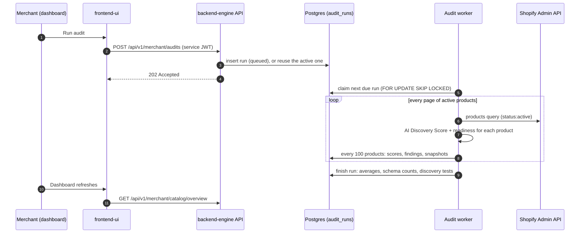

# How the catalog audit works

This guide explains what the catalog audit checks, how each score is calculated, and how an audit runs inside the app. It assumes no background in ecommerce or search. Every number here comes from the code; the source file is named in each section so you can check it.

Companion guides: [catalog-enrichment.md](catalog-enrichment.md) (how missing values are found and written back) and [architecture.md](architecture.md) (the whole system).

---

## 1. The problem in plain words

People increasingly shop by asking an AI assistant: "find me a lightweight hiking backpack around 30 liters". The assistant (we call it an **AI shopping agent**) has to find products that match, compare them, and send the shopper somewhere to buy.

An agent can only recommend what it can understand. If a store's backpack page says "spacious and perfect for adventures" but never states the capacity in a form a program can read, the agent cannot tell whether it is 20 liters or 40, so it skips the product. The store loses the sale without ever knowing it was considered.

The catalog audit answers one question for every product in a store: **could an AI shopping agent understand, compare and recommend this product from its data?** It then tells the merchant exactly what to fix.

## 2. Vocabulary

| Term | Meaning |
|---|---|
| **Merchant** | The business that owns the online store. Our customer. |
| **Shopify** | The ecommerce platform the store runs on. Our app is installed into a Shopify store. |
| **Catalog** | Every product the store sells, with all its data. |
| **Product** | One thing for sale, for example "Trailhead 28L Daypack". It has a title, description, images, a type and a category. |
| **Variant** | A buyable version of a product, for example the blue one in size M. Price, stock, SKU and barcode live on the variant. |
| **Option** | The dimension variants differ on: Size, Color, Material. A product with options Size and Color has one variant per combination. |
| **SKU** | Stock keeping unit. The merchant's own internal code for a variant, such as `TH28-BLU`. |
| **GTIN / barcode** | Global Trade Item Number, the number under a barcode (UPC in North America, EAN in Europe). It is the same for a product no matter who sells it, so agents use it to recognise the same item across stores. It has 8, 12, 13 or 14 digits and ends in a check digit. |
| **Vendor / brand** | Who makes the product. Shopify calls the field "vendor". |
| **Product type** | A free-text label the merchant chooses, such as "Backpack". |
| **Category (taxonomy)** | Shopify's Standard Product Taxonomy: a fixed tree of categories such as `Luggage & Bags > Backpacks`. Unlike product type, everyone uses the same names, so machines can rely on it. Each category also defines standard attributes (Color, Material, Activity). |
| **Tags** | Free-form labels on a product, such as `waterproof` or `material:nylon`. Merchants often hide facts in tags. |
| **Metafield** | A custom, typed field on a Shopify product, addressed as `namespace.key`, for example `custom.capacity_liters` with type `number_decimal`. This is where **structured data** lives. |
| **Structured data** | A fact stored in a field with a type (a number with a unit, yes/no, an item from a list), as opposed to the same fact written inside a sentence. Programs can filter and compare structured data; prose they have to guess at. |
| **Attribute** | One property of a product that shoppers care about: capacity, weight, material, temperature rating. The audit wants each important attribute to be stored as structured data. |
| **Discoverability** | How easily a product can be found by a search or an agent for the questions shoppers actually ask. |
| **JSON-LD** | A block of machine-readable product data embedded in a web page (using the schema.org vocabulary). Our theme extension adds it to the storefront; the installation check verifies it. |
| **llm.txt** | A plain Markdown summary of the store and its products that the app serves for AI agents to read. |

## 3. Three scores, one audit

Each audit gives every product two scores, and the store a set of summary numbers.

| Score | Range | What it asks | Source |
|---|---|---|---|
| **AI Discovery Score** | 0 to 100 | Does the product have the basic data every product should have: a good title, a real description, images, identifiers, prices, a category? | `backend-engine/app/services/catalog_auditor.py` |
| **Readiness score** | 0 to 100 | Does the product have the specific attributes its kind of product needs (a backpack's capacity, a tent's season rating), stored as valid structured data that agrees with the description? | `backend-engine/app/services/readiness.py` |
| **Discovery tests** | count per question | For typical shopper questions, how many products carry every attribute needed to answer them? | `backend-engine/app/jobs/catalog_audit.py` |

The AI Discovery Score is generic: the same rules apply to a backpack and a candle. The readiness score is category-aware and is the one the dashboard treats as the headline number. The readiness score includes the AI Discovery Score as one of its parts (the "foundation" component, worth 20 of 100 by default).

Both scores are internal data-quality measures. They are not any search engine's or AI platform's ranking score.

---

## 4. The AI Discovery Score

### 4.1 How it adds up

The score is the sum of points across eight dimensions. Points are fixed (there is no rescaling), so the maximum is exactly 100.

| Dimension | Max | Why agents care |
|---|---|---|
| Identity | 15 | Title, brand and type tell an agent what the product is. |
| Description | 20 | The description is what an agent quotes and reasons over to answer questions. |
| Media | 15 | Images (and their alt text, which describes the image in words) are shown to shoppers and help agents describe the product. |
| Identifiers | 15 | SKUs and GTINs let an agent identify the exact item and match it across stores. |
| Offers | 10 | An agent cannot recommend what it cannot price or confirm in stock. |
| Taxonomy | 10 | A standard category tells an agent what kind of product this is without guessing. |
| Attributes | 10 | Named options, search-engine metadata and attribute metafields. |
| Reviews | 5 | Ratings help agents rank otherwise similar products. |

### 4.2 Every rule, with its points

When a check fails, the product gets an **issue code** (shown to the merchant with a plain-language message) and loses those points.

| Dimension | Check | Points | Issue code if it fails |
|---|---|---|---|
| Identity | Title is 10 to 150 characters and not shouted in capitals (all caps and longer than 12 characters fails) | 5 | `title_quality` |
| | A vendor is set, or a mapping rule supplies a brand | 5 | `brand_missing` |
| | A product type is set | 5 | `product_type_missing` |
| Description | Plain-text length after removing HTML (a description that just repeats the title counts as empty): 300+ characters = 20, 150+ = 12, 50+ = 6, under 50 = 0 | 0 to 20 | `description_missing` (empty) or `description_short` (under 300) |
| Media | At least one image | 8 | `images_missing` |
| | Every image has alt text (only checked when there are images) | 4 | `image_alt_text_missing` |
| | Three or more images | 3 | `few_images` |
| Identifiers | Every variant has a SKU | 5 | `sku_missing` |
| | Every variant has a valid GTIN = 10; at least one valid GTIN = 5 | 0 to 10 | `gtin_missing` (some or all blank), `gtin_invalid` (wrong length or check digit) |
| Offers | Every variant has a price above zero | 5 | `price_missing` |
| | Inventory is tracked on every variant | 3 | `inventory_untracked` |
| | At least one variant is available for sale | 2 | `unavailable` |
| Taxonomy | A Shopify Standard Product Taxonomy category is assigned | 7 | `category_missing` |
| | Three or more tags | 3 | `tags_sparse` |
| Attributes | Options have real names (not "Title", "Option1", "Default"); products with one variant pass automatically | 3 | `options_unnamed` |
| | SEO title set | 2 | `seo_title_missing` |
| | SEO meta description set | 2 | `seo_description_missing` |
| | At least one attribute metafield with a value (any namespace except `reviews`, `global`, `seo` and Shopify's recommendation namespace), or a mapping rule supplies material, color, size, pattern, age group, gender or care | 3 | `attributes_missing` |
| Reviews | A `reviews.rating` or `reviews.rating_count` metafield exists, or a mapping rule supplies a rating | 5 | `reviews_missing` |

**GTIN check digit.** A GTIN's last digit is computed from the others, which catches typos. The code (`is_valid_gtin`) strips spaces and dashes, requires 8, 12, 13 or 14 digits, then, reading the body right to left, multiplies digits alternately by 3 and 1, sums them, and checks that `(10 - sum mod 10) mod 10` equals the last digit. A single-variant product with no barcode can also get its GTIN from a mapping rule (for example a tag `GTIN-0123456789012`).

### 4.3 Grades and the store score

Each product gets a grade from its score: **excellent** (85 and up), **good** (70 to 84), **needs work** (50 to 69), **poor** (under 50). The store's AI Discovery Score is the plain average across all active products, and the dashboard lists the ten most common issue codes.

### 4.4 Skipping unchanged products

Every scored product also gets a `content_hash`: a SHA-256 of the product data (ignoring the "last updated" timestamp) together with the values mapping rules produced. If a product and the rules have not changed, its hash is the same, which lets later code recognise that nothing needs re-scoring.

---

## 5. The readiness score

### 5.1 Category schemas: what a backpack should know about itself

A generic score cannot know that a backpack needs a capacity and a tent needs a season rating. That knowledge lives in **category schemas** (`backend-engine/app/services/catalog_schema.py`).

A schema lists, for one kind of product:

- **attributes**, each with a type, a unit, an **importance** (critical, high, medium, low), whether it is **required**, an optional list of allowed values (the vocabulary), aliases (words that signal it in text), a plain-language "why it matters", and the default metafield it is written to;
- **variant options** the category expects (jackets and footwear expect a `Size` option);
- **discovery queries**: shopper questions and the attributes needed to answer each one;
- an **auto-approval** rule (off by default; see the enrichment guide).

The app ships six built-in schemas. Merchants can edit them or add their own on the **Category schemas** page; their edits are stored as overrides and validated before saving.

| Schema | Key attributes (importance) | Expected options | Example discovery question |
|---|---|---|---|
| Backpacks | capacity (critical), weight, material, intended use (high), laptop compartment, water resistance (medium) | none | "lightweight hiking backpack around 30 liters" |
| Tents | sleeping capacity (critical), weight, season rating, material (high), waterproof rating (medium) | none | "ultralight 2 person backpacking tent" |
| Sleeping bags | temperature rating (critical), fill type, weight (high) | none | "down sleeping bag rated to 20 degrees" |
| Jackets and outerwear | material (high), water resistance, insulation, weight (medium) | Size | "waterproof hiking rain jacket" |
| Footwear | material (high), water resistance, weight (medium), heel drop (low) | Size | "waterproof hiking boots" |
| General products | material, weight, intended use (medium), care (low) | none | none |

**Attribute types.** Every value has one canonical shape, used everywhere:

| Type | Example value | Notes |
|---|---|---|
| text | `"Ripstop nylon"` | up to 2,000 characters |
| list | `["hiking", "travel"]` | duplicates removed |
| number | `12.5` | the unit is fixed by the definition |
| boolean | `true` | accepts yes/no, true/false, y/n, 1/0 |
| weight | `{"value": 1.2, "unit": "kg"}` | g, kg, oz, lb |
| volume | `{"value": 28, "unit": "l"}` | ml, l |
| dimension | `{"value": 40, "unit": "cm"}` | mm, cm, m, in |

Parsing never guesses: text that cannot be read as the type is an error. Two values in different units are compared by converting both to a base unit with a 2% tolerance, so `1.2 kg` equals `1200 g`.

**Which schema a product gets** (`match_schema`): first the Shopify category name, then the product type, then whole words in the title, each checked against the schema's match lists. Anything unmatched uses "General products".

### 5.2 Reading what the product already has

For each schema attribute, the audit looks for a structured value in this order and takes the first one found (`current_attributes` in `attribute_extractor.py`):

1. the metafield the merchant mapped that attribute to on the **Metafield mapping** page, or the schema's default metafield;
2. otherwise, any metafield whose key equals the attribute key;
3. a value produced by a **meta mapping rule** (section 7);
4. a product option with the attribute's name that has exactly one value (a product whose only Material option value is "Canvas").

The value is parsed and validated against the attribute's type and vocabulary. A value that fails becomes "present but invalid".

Separately, the rule-based extractor reads the product's own text (title, description, tags, option names and values) and notes any attribute that is **stated in prose**. How the extractor works is covered in [catalog-enrichment.md](catalog-enrichment.md#3-the-rule-based-extractor).

### 5.3 The six components

Each component is a fraction from 0 to 1. Components that do not apply to a product are left out, and the remaining weights are rescaled, so a product is never punished for a check that cannot be made.

```
readiness = round( 100 × Σ(weight × value) / Σ(weight) )    over the components that apply
```

| Component | Default weight | Value | When it does not apply |
|---|---|---|---|
| **Completeness** | 30 | Importance-weighted share of schema attributes that have a valid structured value. Weights: critical 4, high 3, medium 2, low 1. | never (every schema has attributes) |
| **Validity** | 15 | Of the structured values present, the share that parse and fit the schema. | no structured values at all |
| **Consistency** | 15 | Of the structured values the description also states, the share that agree. Only numbers, measurements and yes/no are compared; text and lists are not. | nothing to compare |
| **Evidence** | 10 | Of the claims found in the text (section 5.4), the share backed by a structured field. | no claims in the text |
| **Variants** | 10 | Share of variant checks passed: every variant has a SKU, every variant has a price, and (for products with more than one variant) each option the schema expects is present. | product has no variants |
| **Foundation** | 20 | The AI Discovery Score divided by 100. | never |

Merchants can change the weights (0 to 100 each) and the **agent-ready threshold** (default **80**) on the **Settings** page. A product at or above the threshold counts as agent-ready.

### 5.4 Findings: why points were lost

Every lost point traces back to a **finding**: a row with a code, a severity, a message, why it matters, the recommended action and, where possible, quoted evidence. Rule-based findings come from the audit; AI findings (prefixed `ai_`) come from enrichment.

| Code | Raised when | Severity |
|---|---|---|
| `attribute_buried` | The attribute has no structured value, but the text states it ("weighs 850 g" in the description). The fix is to run enrichment, which proposes the value. | high for critical or high attributes, otherwise medium |
| `attribute_missing` | No structured value and not stated anywhere. Only raised for required, critical or high-importance attributes. | the attribute's importance (non-required attributes count as low) |
| `attribute_invalid` | A structured value exists but does not parse or is outside the vocabulary. | high |
| `attribute_contradiction` | A structured value and the text disagree (metafield says 1.2 kg, description says 900 g). | high |
| `claim_unsupported` | The text makes a claim with no structured field behind it (see the claims table below). | medium |
| `description_vague` | The description uses two or more marketing words (versatile, spacious, premium, high quality, perfect for, ultimate, amazing, best in class) and contains no numbers at all. | medium |
| `variant_option_missing` | The product has several variants but no option with the name the schema expects (for example no `Size` on a jacket). | high |
| AI Discovery Score codes | Every issue code from section 4.2 is repeated as a finding so everything appears in one list. | critical for no description or no price; high for no images or an invalid GTIN; medium or low for the rest |

**Claims the audit looks for**, and the attributes that back them:

| Claim in the text | Backed by |
|---|---|
| "waterproof" | water resistance, or a waterproof rating |
| "water resistant" / "water repellent" | water resistance |
| "ultralight", "lightweight" | weight |
| "recycled" | material |
| "certified", "bluesign", "fair trade", "oeko-tex" | certifications |
| "lifetime warranty", "year warranty" | warranty |

### 5.5 Discovery tests

For each discovery question in a product's schema, the audit checks whether the product carries **every** attribute the question needs as a valid structured value. The run stores, per question, how many products are in that schema and how many could answer it. On the dashboard this reads as "12 of 40 backpacks can answer *lightweight hiking backpack around 30 liters*".

This measures whether the data exists. It does not run a search. The separate store search test does that.

---

## 6. The store search test

The audit counts products that *should* be findable. The **Test with store search** button on the dashboard checks whether they *are* found (`backend-engine/app/services/discovery_probe.py`).

For each discovery question it asks the store's own search the way an AI agent would: through the Storefront MCP endpoint every Shopify store exposes at `https://<store>/api/mcp`, using the `search_shop_catalog` tool. (MCP, the Model Context Protocol, is a standard way for AI agents to call tools.) If that endpoint cannot be reached, for example on a password-protected development store, it falls back to the Shopify Admin product search, which is keyword-based, and every result says which search produced it.

For each question it reports:

- the products returned (up to `DISCOVERY_RESULT_LIMIT`, default 10);
- **answerable products**: products in the question's schema that carry every attribute the question needs;
- **recall**: answerable products found in the top results ÷ min(answerable products, result limit). "Of the products that should come up, how many did?"
- **precision**: answerable products found ÷ products returned. "Of what came up, how much was right?"
- up to five answerable products that were missed.

It runs as a background job, and it measures the store's own search, not ChatGPT or any external agent.

---

## 7. Meta mapping rules

Merchants often already have the facts, just not in the place an agent looks: a tag `material:organic-cotton`, a vendor field, or a metafield from another app. A **meta mapping rule** turns those into a named property without editing every product (`backend-engine/app/services/tag_mapper.py`). Merchants manage rules on the **Meta mapping rules** page.

A rule has:

| Field | Meaning |
|---|---|
| source type | Where to look: `tag`, `metafield` (with a `namespace.key`), `product_type` or `vendor`. |
| match pattern | A regular expression that must match the **whole** value (case-insensitive). If it has a capture group, the captured part becomes the value; otherwise the whole value does. |
| target property | The property to set: `brand`, `gtin`, `material`, `color`, `size`, `pattern`, `age_group`, `gender`, `care`, `rating`, a schema attribute key such as `capacity`, or any other name. |
| transform | Optional: a constant output (`{"value": "Organic cotton"}`), a case change (`title`, `upper`, `lower`). By default dashes and underscores become spaces, except for `gtin`. |
| priority | When two rules set the same property, the lower number wins. |
| active | Inactive rules are kept but ignored. |

**Example.** Source `tag`, pattern `material:(.+)`, target `material`, transform `{"case": "title"}`. The tag `material:organic-cotton` produces material = `Organic Cotton`.

**Where rule values count:**

- AI Discovery Score: `brand` satisfies the brand check; `gtin` can supply a single-variant product's barcode; material, color, size, pattern, age group, gender or care satisfy the attribute-metafield check; `rating` satisfies reviews.
- Readiness: a rule whose target is a schema attribute key supplies that attribute's structured value (third in the lookup order in section 5.2).
- The `llm.txt` feed shows mapped properties to agents.

**Live preview.** Before saving, the page calls `POST /api/v1/merchant/mapping-rules/preview`, which reads the store's first 100 active products live from Shopify (only the fields rules use) and returns the matches with their source value and extracted value, the values the pattern did not match (to help fix the pattern), and a flag on any match an existing higher-priority rule would override. A preview saves nothing. Creating, toggling or deleting a rule clears the cached `llm.txt` so agents see the change. The new values reach the scores on the next audit or single-product refresh.

---

## 8. How an audit runs

### 8.1 Step by step



1. **Queue.** `POST /api/v1/merchant/audits` creates an `audit_runs` row with status `queued`, or returns the run that is already queued or running, so double clicks do not start two audits.
2. **Claim.** Every backend replica runs an audit worker. It polls every 5 seconds (and wakes at once when a run is queued on the same replica), and claims the oldest due run with `SELECT … FOR UPDATE SKIP LOCKED`, so two workers never take the same run.
3. **Load configuration.** The merchant's mapping rules, category schemas (built-ins plus overrides), metafield mappings, readiness weights and threshold.
4. **Page through products.** The worker reads every active product from Shopify's GraphQL Admin API page by page, with retries when Shopify throttles.
5. **Score.** Each product gets the AI Discovery Score, then the readiness assessment (schema match, current attributes, findings, readiness score), and the run's discovery-test counters are updated.
6. **Save in batches.** Every 100 products, the worker writes per-product scores (`product_audits`), findings (`audit_findings`) and the latest snapshot of each product (`catalog_products`).
7. **Finish.** The run records the average AI Discovery Score, the average readiness, the count of products per schema, the number of agent-ready products, and the discovery-test results.

### 8.2 Failures and retries

- A worker updates a **heartbeat** every 15 seconds. If a worker dies, its heartbeat goes stale after 120 seconds and another worker claims the run again.
- Each claim increments an **attempt** number. Every write is "fenced" on that number, so a slow, abandoned attempt cannot overwrite the new attempt's results.
- A transient failure is retried after `60 s × attempt`, up to 3 attempts. A permanent failure (the store uninstalled the app, or Shopify rejected the token) fails the run at once.
- On a graceful shutdown the worker hands the run back to the queue without using up an attempt.

All of these are configurable: `AUDIT_POLL_SECONDS`, `AUDIT_HEARTBEAT_SECONDS`, `AUDIT_STALE_SECONDS`, `AUDIT_MAX_ATTEMPTS`, `AUDIT_RETRY_BACKOFF_SECONDS`, `AUDIT_WORKER_ENABLED`.

### 8.3 Keeping scores current between audits

A full audit is not needed after every edit:

- When Shopify sends a `products/update` webhook, the product's snapshot is updated straight away and a **refresh** job is queued after `REFRESH_DELAY_SECONDS` (default 10), so a burst of edits becomes one refresh. The refresh re-reads that one product, re-scores it, and replaces its row and rule findings in the latest audit.
- Publishing approved values or reverting a write queues the same refresh.
- `products/delete`, or a product leaving the active catalog, marks the snapshot removed and closes its open suggestions.

Store-level averages and the trend chart only change on the next full audit.

### 8.4 Where the results live

| Table | Holds |
|---|---|
| `audit_runs` | One row per audit: status, attempts, timing, products scanned, average scores, run stats (schema counts, ready products, discovery tests). |
| `product_audits` | One row per product per run: AI Discovery Score, per-dimension breakdown, issue codes, readiness score and breakdown, schema, content hash. |
| `audit_findings` | One row per finding (rule findings per run, AI findings per enrichment job). |
| `catalog_products` | The latest snapshot of each product: identity fields, schema, current structured attributes, both scores, sync times. |
| `catalog_jobs` | Refresh, publish and store-search-test jobs. |

The dashboard reads these through `/api/v1/merchant/audits/*` and `/api/v1/merchant/catalog/*` (overview, runs, products, product detail, findings, discovery runs).

---

## 9. A worked example

**The product.** "Trailhead 28L Daypack" from vendor Northpeak, product type Backpack, Shopify category `Luggage & Bags > Backpacks`, two tags, two variants (option `Color`: Blue, Green), both with SKUs and prices, inventory tracked, one valid barcode and one blank. Two images, both with alt text. An SEO description but no SEO title. No metafields. The 220-character description reads:

> A lightweight daypack for hiking and everyday carry. 28 L capacity with a padded back panel. Made from ripstop nylon. Weighs 850 g.

**AI Discovery Score: 71 (good).**

| Dimension | Points | Why |
|---|---|---|
| Identity | 15 / 15 | title length fine, vendor set, type set |
| Description | 12 / 20 | 220 characters (150 to 299) → `description_short` |
| Media | 12 / 15 | images 8 + alt text 4; only 2 images → `few_images` |
| Identifiers | 10 / 15 | SKUs 5; one valid GTIN of two 5 → `gtin_missing` |
| Offers | 10 / 10 | priced, tracked, available |
| Taxonomy | 7 / 10 | category 7; 2 tags → `tags_sparse` |
| Attributes | 5 / 10 | option named 3, SEO description 2; no SEO title, no attribute metafield |
| Reviews | 0 / 5 | no rating |

**Readiness before enrichment: 35.** The product matches the Backpacks schema (its category contains "backpacks"). The schema's attributes have importance weights summing to 20 (capacity 4; weight, material, intended use 3 each; laptop compartment and water resistance 2 each; max laptop size, carry-on and care 1 each).

| Component | Weight | Value | Notes |
|---|---|---|---|
| Completeness | 30 | 0 | no structured attributes at all |
| Validity | 15 | n/a | nothing structured to validate |
| Consistency | 15 | n/a | nothing structured to compare |
| Evidence | 10 | 0 | "lightweight" is claimed, no weight field backs it |
| Variants | 10 | 1 | SKUs and prices on every variant; backpacks expect no option |
| Foundation | 20 | 0.71 | the AI Discovery Score |

`100 × (30×0 + 10×0 + 10×1 + 20×0.71) / (30 + 10 + 10 + 20) = 34.6`, which rounds to **35**. The findings say why: capacity (28 L), weight (850 g), material (ripstop nylon) and intended use (hiking, everyday) are each `attribute_buried`, "lightweight" is a `claim_unsupported`, and the AI Discovery Score gaps are listed too. The discovery question "lightweight hiking backpack around 30 liters" is not answerable.

**Readiness after the merchant enriches and publishes those four values: 84 (agent-ready).**

| Component | Value | Notes |
|---|---|---|
| Completeness | 0.65 | 13 of 20 importance points (4 + 3 + 3 + 3) |
| Validity | 1 | all four values valid |
| Consistency | 1 | capacity and weight both agree with the description (text and list attributes are not compared) |
| Evidence | 1 | "lightweight" is now backed by weight |
| Variants | 1 | unchanged |
| Foundation | 0.74 | the attribute-metafield check now passes (+3) |

`30×0.65 + 15 + 15 + 10 + 10 + 20×0.74 = 84.3`, so **84**, and the discovery question is now answerable. The remaining gap is mostly the five optional attributes the description does not mention, which the merchant can add by hand.

---

## 10. Limits worth knowing

- The scores measure data quality, not ranking. A high score makes a product understandable; it does not guarantee any agent recommends it.
- Built-in schemas cover outdoor gear. Other verticals start on "General products" until the merchant adds a schema.
- Consistency only compares numbers, measurements and yes/no values; a text attribute that contradicts the description is not caught by rules (the AI review may flag it).
- A single-product refresh updates that product, but store averages wait for the next full audit.
- The store search test measures the store's own search, not external agents.
