# Project flow

End to end, from a merchant installing the app to an AI agent sending a shopper to the store's own Shopify checkout. The flow has seven stages:

1. **Onboarding.** The merchant installs the app and turns on the theme blocks that add machine-readable product data to the storefront.
2. **Storefront check.** The installation check confirms agents can read the storefront.
3. **Catalog audit.** A background audit scores every product (AI Discovery Score and readiness) and explains what is missing. See [catalog-audit.md](catalog-audit.md).
4. **Enrichment and write-back.** The app proposes missing values from each product's own text, the merchant reviews them, and approved values are written to Shopify. See [catalog-enrichment.md](catalog-enrichment.md).
5. **Agent access.** The merchant issues an API key per agent.
6. **Discovery and checkout.** Agents read the catalog, build priced carts, and hand the shopper a checkout link.
7. **Follow-up.** The merchant sees agent carts and fulfils orders as usual.

See [architecture.md](architecture.md) for the design behind each step.

The diagram source is below; GitHub renders it too. To re-render the PNG, copy the block into `flow.mmd` and run `npx -p @mermaid-js/mermaid-cli mmdc -i flow.mmd -o flow.png -s 2 -b white`.

```mermaid
flowchart TD
  %% ================= 1. Onboarding =================
  subgraph S1["1 · Merchant onboarding"]
    direction TB
    A1(["Merchant installs the app<br/>from Shopify admin"]) --> A2["frontend-ui: Shopify OAuth<br/>session saved via Prisma"]
    A2 --> A3["afterAuth hook<br/>POST /internal/merchants/sync<br/>service JWT"]
    A3 --> A4[("merchants row<br/>offline token encrypted")]
    A4 --> A5["Setup guide: turn on theme blocks<br/>Product + Store JSON-LD"]
  end

  %% ================= 2. Storefront check =================
  subgraph S2["2 · Storefront check"]
    direction TB
    B1["Dashboard: Run installation check"] --> B2["Fetch storefront, product page,<br/>robots.txt, llms.txt<br/>SSRF-guarded"]
    B2 --> B3{"JSON-LD, metadata,<br/>app block, AI crawlers OK?"}
    B3 -- "No" --> B4["Findings + fixes<br/>shown to merchant"]
    B3 -- "Yes" --> B5["Check passed"]
  end

  %% ================= 3. Catalog audit =================
  subgraph S3["3 · Catalog audit"]
    direction TB
    C0["Meta mapping rules page<br/>tags, vendor, type, metafields<br/>to properties, live preview"] -.-> C3
    C1["Dashboard: Run audit"] --> C2[("audit_runs: queued")]
    C2 --> C3["Audit worker claims run<br/>SKIP LOCKED + heartbeat"]
    C3 --> C4["Page active products<br/>from Shopify Admin GraphQL"]
    C4 --> C5["Per product: AI Discovery Score<br/>8 dimensions"]
    C5 --> C6["Match category schema,<br/>read structured attributes,<br/>findings, readiness 0-100"]
    C6 --> C7{"Attempt OK?"}
    C7 -- "Transient error" --> C2
    C7 -- "Done" --> C8["Dashboard: readiness, agent-ready count,<br/>what to fix first, discovery tests"]
    C8 --> C9["Optional: Test with store search<br/>Storefront MCP, recall and precision"]
  end

  %% ================= 4. Enrichment =================
  subgraph S4["4 · Enrichment and write-back"]
    direction TB
    D1["Pick products, or lowest readiness N"] --> D2[("enrichment_jobs: queued")]
    D2 --> D3["Worker re-reads each product"]
    D3 --> D4["Rule extractor<br/>+ optional AI model"]
    D4 --> D5{"Quote exists in product<br/>and states the value?"}
    D5 -- "No" --> D6["Unknown: merchant fills it in"]
    D5 -- "Yes" --> D7[("Suggestion: pending<br/>value, quote, confidence")]
    D7 --> D8{"Auto-approval on and<br/>all conditions met?"}
    D8 -- "No" --> D9["Review queue:<br/>approve, edit, reject"]
    D8 -- "Yes" --> D10["Approved"]
    D9 --> D10
    D6 --> D9
    D10 --> D11["Write preview:<br/>create, update, unchanged, blocked"]
    D11 -- "confirm" --> D12["Publish job: metafieldsSet<br/>with compareDigest,<br/>category metafields"]
    D12 --> D13["Logged and revertible"]
    D13 --> D14["Refresh job re-scores the product"]
  end

  %% ================= 5. Agent access =================
  subgraph S5["5 · Give agents access"]
    direction TB
    E1["Agent access page:<br/>create API key per agent<br/>ACP, UCP or MCP"] --> E2[("agent_clients<br/>argon2 hash, shown once")]
  end

  %% ================= 6. Discovery and checkout =================
  subgraph S6["6 · Agent discovers the store and builds a cart"]
    direction TB
    F1(["AI shopping agent"]) --> F2["Reads storefront JSON-LD"]
    F1 --> F3["GET llm.txt<br/>catalog as Markdown,<br/>cached 10 min in Postgres"]
    F1 --> F4["GET /.well-known/ucp<br/>endpoints, no payment handlers"]
    F2 --> F5
    F3 --> F5
    F4 --> F5
    F5["Create cart: ACP, UCP or MCP<br/>API key + Idempotency-Key"] --> F6["Check live stock,<br/>price via draftOrderCalculate"]
    F6 --> F7{"Sellable lines? Ships to<br/>the address, if given?"}
    F7 -- "Missing" --> F8["Cart open + messages"]
    F8 --> F6
    F7 -- "Complete" --> F9["Cart ready: checkout_url<br/>Shopify cart permalink,<br/>email and address prefilled"]
    F9 --> F10["Agent sends shopper the link<br/>ACP continue_url,<br/>UCP requires_escalation"]
    F10 --> F11["Shopper pays on the store's<br/>own Shopify checkout"]
    F11 --> F12(["Normal Shopify order<br/>cart attribute _agentic_cart_id"])
    F12 -.-> F13["orders/create webhook links<br/>order to cart (currently off,<br/>needs protected data access)"]
  end

  %% ================= 7. Follow-up =================
  subgraph S7["7 · Merchant follows up"]
    direction TB
    G1["Agent checkouts page:<br/>every agent cart, link, order"] --> G2["Fulfil in Shopify as usual"]
    G3["products/update and delete webhooks"] --> G4["Snapshot updated,<br/>refresh queued"]
    G5["Uninstall or GDPR webhooks<br/>HMAC verified, de-duplicated"] --> G6["Merchant marked uninstalled,<br/>token wiped, keys stop working"]
  end

  A5 --> B1
  A5 --> C1
  C8 --> D1
  D14 --> C8
  B5 --> E1
  C8 --> E1
  E2 --> F1
  D12 -.->|"better data in feeds"| F3
  F9 --> G1
  F12 --> G2
  F13 -.-> G1
```

## Stage notes

**Storefront check vs catalog audit.** The installation check looks at the live storefront pages (is the JSON-LD there, can AI crawlers get in). The audit looks at the product data inside Shopify. Both matter: perfect data is useless if crawlers are blocked, and a perfect page is useless if the data behind it is empty.

**Audit to enrichment loop.** The audit finds attributes that are stated in the description but not stored as structured fields (`attribute_buried`). Enrichment turns exactly those into suggestions. After a publish, a refresh job re-scores each written product, so the dashboard moves without a full audit. Store averages and the trend update on the next full audit.

**Mapping rules.** If a merchant already keeps facts in tags or metafields, a mapping rule credits them on the next audit without enrichment. The rule page previews matches against the store's first 100 active products before saving.

**Order linking is off for now.** The `orders/create` subscription is commented out in `shopify.app.toml`, because Shopify refuses order-topic subscriptions until the app has protected customer data access. Until it is turned back on, a cart is never marked `completed` when the shopper pays, and the Agent checkouts page does not show the order. The shopper's purchase itself is unaffected.
