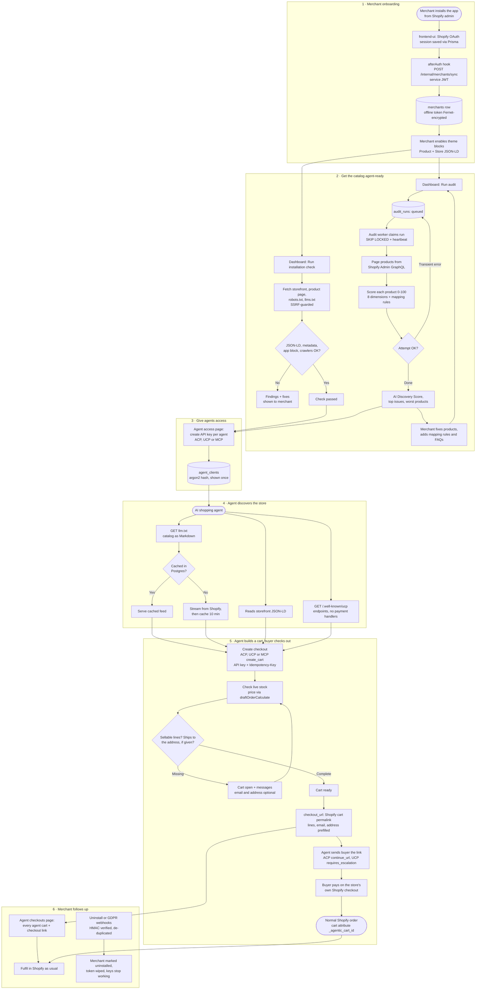

# Project flow

End to end: merchant install, catalog readiness (installation check and the durable audit queue), agent API keys, agent discovery, agent carts handed off to the store's Shopify checkout, and merchant follow-up. See [architecture.md](architecture.md) for the design behind each step.

The diagram source is below; GitHub renders it too. To re-render the PNG: `npx -p @mermaid-js/mermaid-cli mmdc -i flow.mmd -o flow.png -s 2 -b white` after copying the block into `flow.mmd`.

